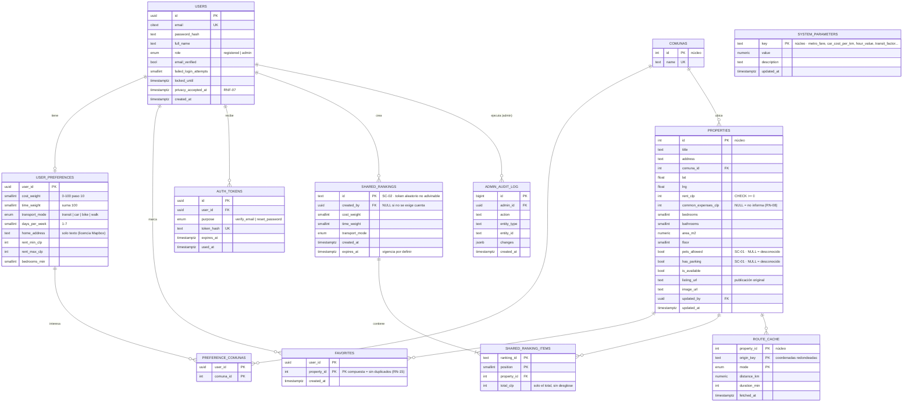

# EasyArriendo · Estado del proyecto, modelo de datos y plan de backend

Fuentes revisadas (22/11/2026):

- Carpeta *GPTI grupo 8* completa (Entregas 1, 2 y 3, Feedback E2, solicitudes de cambio).
- *Documento de requerimientos de software v1.0* (09/10/2026). La copia en Drive es idéntica a la usada aquí.
- Este repositorio (frontend React con datos mock).

---

## 1. Estado actual del proyecto

### Fechas que mandan

| Hito | Fecha | Estado |
| --- | --- | --- |
| H1 Entrega 1 / H2 Avance 1 | 08–10/09 | Completado |
| H3–H4 Entrega 2 / Avance 2 | 22–27/10 | Completado (nota 6,8; feedback abajo) |
| H5 Corte de métricas | 10/11 (curso) · 11/11 (interno) | Plantilla de métricas sin llenar |
| **EV7 Reunión de cierre + H6 Entrega 3** | **24/11** | **En 2 días** |
| **H7 Presentación final** | **26/11** | **En 4 días** |

### Documentos de la carpeta

| Entrega | Documento | Estado |
| --- | --- | --- |
| 1 | 1.1.1 Caso de negocio, 1.2.1 Acta de constitución, 1.3 Registro de interesados, 1.4 Acta del equipo, 1.5 Reporte de avance | Completos (existe versión "Arreglado") |
| 2 | 2.1 Requerimientos, 2.2 Cronograma (3 versiones), 2.3 Presupuesto (firmado), 2.4 Plan de pruebas, 2.5 Registro de riesgos, 2.6 Reporte de avance, 2.7 EDT | Completos y evaluados |
| 2 | Feedback E2, Rúbricas E2, Solicitudes de cambio G8S2 | Insumos del curso |
| 3 | 3.2 Solicitud de cambios 1 y 2 | **Completas** |
| 3 | 3.1 Métricas, 3.3 Certificado de aceptación, 3.4 Acta de cierre, 3.5 Lecciones aprendidas, Reporte semanal | **Plantillas vacías** |
| — | Video "Flujo MVE", 8 fotos de mockup, Semana 3 AP | Material de apoyo |

### Avance técnico según el cronograma actualizado

- El desarrollo debía partir el 28/10. Solo figura "3.1.1 Recopilar dataset de propiedades" en curso (50 %). Todos los demás paquetes de desarrollo (3.x a 7.x) y el alcance agregado (A01–A10) están **pendientes** o "por validar".
- El frontend existe en este repo con datos mock. **El backend no existe.**

### Feedback de la Entrega 2 que afecta el producto

- **RN-26 incompleta** (fórmula del ranking con "REVISAR"). Hay que cerrarla antes de programar el ranking.
- Falta la sección "Otros requerimientos".
- El presupuesto pasó de $100.000 (acta) a $11.435.450 al sumar el alcance A01–A10. Conviene explicarlo en el cierre.

### Cambios aprobados que el backend debe incluir

**SC-01 · Filtros "admite mascotas" y "con estacionamiento"** (aprobado)
- Casillas tipo checklist que solo filtran el listado. **No** afectan el cálculo de costos.
- La muestra debe distinguir "sí", "no" y "desconocido" para no presentar como confirmados los datos que no lo están.

**SC-02 · Compartir el ranking por enlace / WhatsApp** (aprobado el 06/11)
- El enlace muestra el orden y el **costo total** por propiedad, **sin desglose**.
- No se expone la ubicación del usuario: ni en la URL ni en la respuesta de la API.
- La búsqueda no requiere registro. Los permisos para generar el ranking no cambian.
- Pendiente: vigencia del enlace, mecanismo de almacenamiento y permisos para abrirlo.

### Riesgos registrados relevantes para el backend

| Riesgo | Contenido | Implicancia para el backend |
| --- | --- | --- |
| R-01 | Cuota de Mapbox | Plan de respuesta: caché de consultas y OSRM como respaldo |
| R-02 | Scraper de TOCTOC | Extraer una sola vez y guardar estático en PostgreSQL |
| R-03 | Calibración del ranking | Validar la fórmula en Excel con el sponsor |
| R-05 | Sobrecarga académica | Ceñirse al MVP |

---

## 2. Brecha: frontend actual vs. requerimientos

| Funcionalidad | Frontend hoy | Falta |
| --- | --- | --- |
| F-01 Buscar y filtrar (+SC-01) | 8 propiedades mock, filtros en cliente | Dataset real en BD, `GET /properties`, filtros mascotas/estacionamiento |
| F-02 Traslado | 3 destinos fijos, tiempos inventados | Geocoding de dirección libre + Mapbox Matrix |
| F-03 Costo real | Cálculo con parámetros distintos a RN-22–24 | Cálculo en backend con parámetros del sistema |
| F-04 Comparación | Hecha, mapa esquemático | Endpoint de comparación, mapa real |
| F-05 Ranking (+SC-02) | Min-max normalizado | RN-26 cerrada, endpoint, enlace compartible |
| F-06 / F-07 Preferencias y favoritos | `localStorage` | Tablas y endpoints (requieren cuentas) |
| F-08 / F-09 Admin y cuentas | No existe | Panel, endpoints, auditoría |
| F-10 Registro / login | Cuenta demo | Auth real |

Diferencias del cálculo actual con las reglas de negocio:

| Regla | Documento | Frontend |
| --- | --- | --- |
| Semanas por mes (RN-22) | 4 | 4,4 |
| Transporte público (RN-23) | $895 por viaje | $1.186 |
| Auto (RN-23) | km × $110 | km × $180 + $1.000 |
| Importancia por defecto (RN-25) | 50/50 | 60/40 |
| Escala de importancia (RN-25) | Pasos de 10, suma 100 | Libre |
| Días por semana (RN-25) | 1–7 | 0–7 |

**Mapbox no tiene perfil de transporte público.** Solo ofrece `driving`, `driving-traffic`, `walking` y `cycling`, con un máximo de 25 coordenadas y 60 solicitudes por minuto en la Matrix API. El paquete A08 asumía integrar micro y metro, pero en 2 días no es viable. Para la entrega: estimar el tiempo de transporte público a partir de `driving` con factores configurables y mostrarlo como "estimado" (RN-09). Hay que documentarlo como desviación.

---

## 3. Modelo entidad-relación

Modelo completo, alineado a los requerimientos y a SC-01/SC-02. Las tablas marcadas **[núcleo]** son las mínimas para la Entrega 3.

### Decisiones de diseño

- **Visitante (RN-16):** no tiene filas. Su ubicación viaja en la solicitud de comparación y solo vive en el navegador.
- **SC-02 sin datos personales:** `shared_rankings` guarda solo ids de propiedades, posición y total. No guarda origen, desglose ni distancia. Así no hay ubicación que filtrar y RN-16 se puede mantener si se documenta.
- **`route_cache`:** usa coordenadas redondeadas (~100 m), sin vínculo con un usuario. Responde al plan de R-01 y a RNF-03.
- **`admin_audit_log`:** solo inserción (RNF-08), sin `UPDATE` ni `DELETE` para el rol de la API.
- **`system_parameters`:** guarda las tarifas y los valores por defecto (RNF-15).

---

## 4. Avance al 22/11 y pendientes para la Entrega 3

El backend vive en el repositorio aparte `EasyArriendo-Backend-GPTI` (ver su README).

### Hecho y probado en local

| Ámbito | Estado |
| --- | --- |
| Modelo de datos completo + migración Alembic + carga de muestra demo (31 propiedades ficticias) | ✅ |
| F-01 + SC-01: listado paginado con filtros, incluidos mascotas y estacionamiento | ✅ |
| F-02 / F-03: geocoding, rutas (Mapbox o estimación local), costo real con RN-22 a RN-24, "traslado no disponible" y reintento | ✅ |
| F-04: comparación para visitantes sin guardar datos | ✅ |
| F-05 + SC-02: ranking (fórmula RN-26 del frontend) con explicación, enlace compartible y WhatsApp | ✅ |
| F-06 / F-07: preferencias y favoritos persistentes | ✅ |
| F-10: registro, verificación por correo, login con bloqueo, recuperación de contraseña | ✅ |
| F-09: editar datos, contraseña, descargar datos, eliminar cuenta | ✅ |
| F-08 (API): edición de propiedades y parámetros con auditoría | ✅ solo API, sin pantalla |
| Pruebas: 27 tests de backend (PR-06, PR-09, PR-10, PR-13, permisos, bloqueo) + 6 de frontend | ✅ |
| Recorrido en navegador: escritorio y 360 px | ✅ |

### Pendiente

1. **Cuentas gratuitas** (las crea el equipo): Supabase, Mapbox, Brevo y Render. Luego desplegar según los README.
2. **Muestra real:** completar `data/properties.template.csv` con 30–40 avisos públicos y cargarla con `--replace`.
3. **Evidencias del plan de pruebas:** PR-04 (comparar con un mapa manual, requiere token de Mapbox), PR-11 y PR-12 (usuarios de prueba).
4. **Fuera de alcance (documentar en el acta de cierre y las lecciones aprendidas):**
   - Pantalla de administración.
   - Oposición al tratamiento como acción separada.
   - Transporte público con datos reales (A08).
   - Pruebas de carga y compatibilidad (A06).
   - Respaldo y restauración (A07).

---

## 5. API REST completa (referencia para la versión siguiente)

| Grupo | Endpoints |
| --- | --- |
| Público | `GET /properties`, `GET /properties/{id}`, `GET /comunas`, `GET /geocode`, `GET /parameters/public`, `POST /comparisons`, `GET /shared-rankings/{id}` |
| Auth (F-10) | `POST /auth/register`, `/auth/verify-email`, `/auth/login`, `/auth/forgot-password`, `/auth/reset-password` |
| Registrado | `GET/PATCH /me`, `PUT /me/password`, `GET /me/data-export`, `POST /me/objection`, `DELETE /me`, `GET/PUT/DELETE /me/preferences`, `GET /me/favorites`, `PUT/DELETE /me/favorites/{id}`, `POST /rankings`, `POST /shared-rankings` |
| Admin | `PATCH /admin/properties/{id}`, `GET /admin/users`, `PATCH /admin/users/{id}`, `GET /admin/audit-log`, `GET/PUT /admin/parameters/{key}` |

---

## 6. Decisiones tomadas

1. **RN-26:** se usa la fórmula del frontend: puntaje = 100 × (1 − (w_costo · costo_norm + w_tiempo · tiempo_norm)), con normalización min-max entre las propiedades comparadas. Desempate por menor costo real y luego por id.
2. **Dataset:** curación manual en CSV. No se hace scraping.
3. **Ranking:** requiere cuenta registrada y verificada (RN-14).
4. **SC-02:** el enlace vence en 30 días, lo puede abrir cualquiera y no contiene datos personales.
5. **Repositorio:** el backend va en un repo aparte.
6. **Infraestructura:** todo en planes gratuitos (Render, Supabase, Mapbox sin tarjeta, Brevo).
7. **Geocoding:** Mapbox no permite guardar sus resultados gratuitos. Las coordenadas de las propiedades se obtienen con OpenStreetMap (Nominatim) y del usuario solo se guarda el texto de la dirección.
